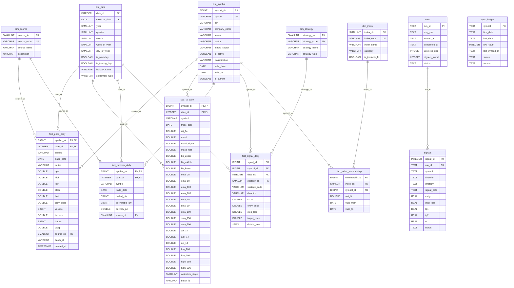
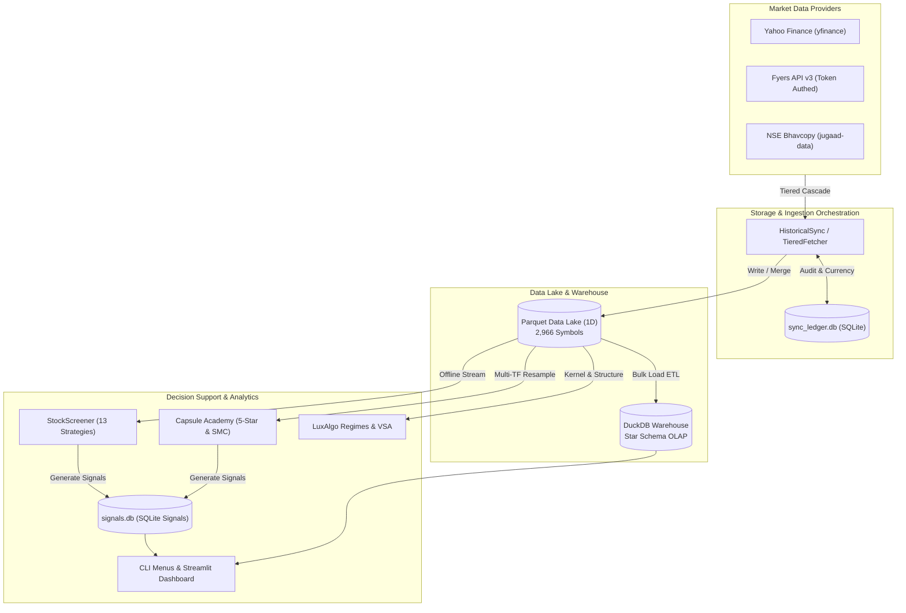

# Fortune ADSS: Data Lake & Database Architecture Reference with ERD

**Application:** Fortune Analytical Decision-Support System (Fortune ADSS)  
**Document:** Data Architecture, Storage Hierarchy, Schemas & Entity-Relationship Diagrams  
**Last Updated:** 2026-11-18  

---

## 1. Executive Storage Architecture

Fortune ADSS utilizes a **hybrid 3-tier local storage architecture** designed for offline-first resilience, ultra-fast analytical screening, and full auditability:

```
  ┌────────────────────────────────────────────────────────────────────────┐
  │                        INCOMING DATA STREAMS                           │
  │  1. Yahoo Finance (yfinance) · 2. Fyers API v3 · 3. jugaad-data Bhavcopy│
  └───────────────────────────────────┬────────────────────────────────────┘
                                      │
                                      ▼
  ┌────────────────────────────────────────────────────────────────────────┐
  │ TIER 1: PARQUET DATA LAKE (Local Filesystem)                           │
  │ • Location: data/historical/1d/{SYMBOL}.parquet (~2,966 symbols)       │
  │ • Format: Columnar, Snappy-compressed, pre-computed TA indicators     │
  │ • Role: High-throughput offline screening and multi-timeframe resample │
  └───────────────────┬────────────────────────────────┬───────────────────┘
                      │                                │
                      ▼                                ▼
  ┌───────────────────────────────────────┐  ┌─────────────────────────────┐
  │ TIER 2: ANALYTICAL OLAP WAREHOUSE     │  │ TIER 3: OPERATIONAL SQLITE  │
  │ • Engine: DuckDB (data/warehouse.duckdb)│  │ • data/sync_ledger.db       │
  │ • Topology: Enterprise Star Schema     │  │   (Sync status & currency) │
  │ • 5 Materialized Dimensions (SCD-2)   │  │ • data/signals.db           │
  │ • 9 Fact & Audit Tables               │  │   (Generated trades & runs) │
  └───────────────────────────────────────┘  └─────────────────────────────┘
```

---

## 2. Tier 1: Parquet Data Lake (Filesystem Layer)

- **Path:** `data/historical/1d/{SYMBOL}.parquet`
- **Volume:** ~2,966 equity files covering up to 25+ years of daily OHLCV.
- **Engine:** PyArrow / Polars columnar engine.

### Schema per Parquet File

| Column Name | Data Type | Description |
|:---|:---|:---|
| `Date` | `Datetime(ns)` | Session date (primary time index) |
| `Open` | `Float64` | Session opening price |
| `High` | `Float64` | Session high price |
| `Low` | `Float64` | Session low price |
| `Close` | `Float64` | Session close / settlement price |
| `Volume` | `Float64` | Total contracts / shares traded |
| `RSI_14` | `Float64` | 14-period Wilder's Relative Strength Index |
| `MACD` | `Float64` | 12-26 Exponential MACD line |
| `MACD_SIGNAL` | `Float64` | 9-period MACD signal line |
| `MACD_HIST` | `Float64` | MACD momentum histogram ($\text{MACD} - \text{Signal}$) |
| `BB_UPPER` | `Float64` | 20-period $+2\sigma$ upper Bollinger Band |
| `BB_MIDDLE` | `Float64` | 20-period simple moving average |
| `BB_LOWER` | `Float64` | 20-period $-2\sigma$ lower Bollinger Band |
| `EMA_20` | `Float64` | 20-day Exponential Moving Average |
| `EMA_50` | `Float64` | 50-day Exponential Moving Average |
| `EMA_100` | `Float64` | 100-day Exponential Moving Average |
| `EMA_200` | `Float64` | 200-day Exponential Moving Average |
| `SMA_20` | `Float64` | 20-day Simple Moving Average |
| `SMA_50` | `Float64` | 50-day Simple Moving Average |
| `SMA_100` | `Float64` | 100-day Simple Moving Average |
| `SMA_150` | `Float64` | 150-day Simple Moving Average |
| `SMA_200` | `Float64` | 200-day Simple Moving Average |
| `ATR_14` | `Float64` | 14-day Average True Range |
| `ADX_14` | `Float64` | 14-day Average Directional Index |
| `PLUS_DI_14` | `Float64` | 14-day Positive Directional Indicator ($+\text{DI}$) |
| `MINUS_DI_14` | `Float64` | 14-day Negative Directional Indicator ($-\text{DI}$) |
| `CCI_14` | `Float64` | 14-period Commodity Channel Index |
| `20D_LOW` | `Float64` | Rolling 20-day minimum price |
| `126D_LOW` | `Float64` | Rolling 6-month (126-day) minimum price |
| `200D_LOW` | `Float64` | Rolling 200-day minimum price |
| `55D_HIGH` | `Float64` | Rolling 55-day Donchian breakout level |
| `52W_HIGH` | `Float64` | 52-week rolling peak close |
| `52W_LOW` | `Float64` | 52-week rolling trough close |
| `RSI_Divergence` | `String` | Bullish / Bearish divergence classification |
| `MACD_Divergence`| `String` | Bullish / Bearish divergence classification |

---

## 3. Tier 2: DuckDB Star-Schema Warehouse (`data/warehouse.duckdb`)

DuckDB manages the dimensional analytical model defined in `src/platform/migrations/V001__initial_schema.sql`.

### 3.1 Dimensions (Master & Reference Data)

#### 1. `dim_symbol` (Slowly Changing Dimension Type 2)
Tracks corporate lifecycle changes, symbol transitions, and health categories.
- `symbol_sk` (BIGINT, PK, Sequence)
- `symbol` (VARCHAR, NOT NULL) — e.g. `'RELIANCE'`, `'TCS'`
- `isin` (VARCHAR) — National security identifier
- `company_name` (VARCHAR, NOT NULL)
- `series` (VARCHAR, DEFAULT `'EQ'`)
- `sector` (VARCHAR)
- `macro_sector` (VARCHAR)
- `is_active` (BOOLEAN, DEFAULT TRUE)
- `classification` (VARCHAR, DEFAULT `'HEALTHY'`) — `HEALTHY`, `ILLIQUID`, `DELISTED`
- `valid_from` (DATE) / `valid_to` (DATE) — Temporal bounds
- `is_current` (BOOLEAN, DEFAULT TRUE) — Current active record flag

#### 2. `dim_date` (Conformed Calendar Dimension)
- `date_sk` (INTEGER, PK) — Format `YYYYMMDD` (e.g., `20261118`)
- `calendar_date` (DATE, UNIQUE)
- `year` (SMALLINT), `quarter` (SMALLINT), `month` (SMALLINT)
- `week_of_year` (SMALLINT), `day_of_week` (SMALLINT)
- `is_weekday` (BOOLEAN), `is_trading_day` (BOOLEAN)
- `holiday_name` (VARCHAR), `settlement_type` (VARCHAR, DEFAULT `'T+1'`)

#### 3. `dim_index`
- `index_sk` (SMALLINT, PK, Sequence)
- `index_code` (VARCHAR, UNIQUE) — e.g., `'NIFTY 50'`, `'NIFTY BANK'`
- `index_name` (VARCHAR), `category` (VARCHAR)
- `is_tradable_fo` (BOOLEAN)

#### 4. `dim_source`
- `source_sk` (SMALLINT, PK, Sequence)
- `source_code` (VARCHAR, UNIQUE) — `'yfinance'`, `'fyers'`, `'bhavcopy'`, `'nse_charts'`
- `source_name` (VARCHAR), `description` (VARCHAR)

#### 5. `dim_strategy`
- `strategy_sk` (SMALLINT, PK, Sequence)
- `strategy_code` (VARCHAR, UNIQUE) — e.g., `'VCP'`, `'TTM_SQUEEZE'`, `'CAPSULE_5STAR'`
- `strategy_name` (VARCHAR), `strategy_type` (VARCHAR)

---

### 3.2 Fact Tables

#### 1. `fact_price_daily` (Daily Price Action)
- `PRIMARY KEY (symbol_sk, date_sk)`
- `symbol_sk` $\rightarrow$ `dim_symbol.symbol_sk`
- `date_sk` $\rightarrow$ `dim_date.date_sk`
- `symbol` (VARCHAR), `trade_date` (DATE), `series` (VARCHAR)
- `open`, `high`, `low`, `close`, `last`, `prev_close` (DOUBLE)
- `volume` (BIGINT), `turnover` (DOUBLE), `trades` (BIGINT), `vwap` (DOUBLE)
- `source_sk` $\rightarrow$ `dim_source.source_sk`
- `batch_id` (VARCHAR), `created_at` (TIMESTAMP)

#### 2. `fact_ta_daily` (Technical Analysis Indicators)
- `PRIMARY KEY (symbol_sk, date_sk)`
- `symbol_sk`, `date_sk`, `symbol`, `trade_date`
- `rsi_14`, `macd`, `macd_signal`, `macd_hist` (DOUBLE)
- `bb_upper`, `bb_middle`, `bb_lower` (DOUBLE)
- `ema_20`, `ema_50`, `ema_100`, `ema_200` (DOUBLE)
- `sma_20`, `sma_50`, `sma_100`, `sma_150`, `sma_200` (DOUBLE)
- `atr_14`, `adx_14`, `plus_di_14`, `minus_di_14`, `cci_14` (DOUBLE)
- `low_20d`, `low_126d`, `low_200d`, `high_55d`, `high_52w`, `low_52w` (DOUBLE)
- `rsi_divergence`, `macd_divergence` (VARCHAR)
- `weinstein_stage` (SMALLINT), `ma_10w` (DOUBLE), `ma_10w_slope` (DOUBLE)
- `nwe_upper`, `nwe_lower`, `vol_ratio_50` (DOUBLE)

#### 3. `fact_delivery_daily` (Delivery Volume Metrics)
- `PRIMARY KEY (symbol_sk, date_sk)`
- `traded_qty` (BIGINT), `deliverable_qty` (BIGINT), `delivery_pct` (DOUBLE)

#### 4. `fact_signal_daily` (Strategy Decision Signals)
- `signal_id` (BIGINT, PK, Sequence)
- `symbol_sk` $\rightarrow$ `dim_symbol`, `date_sk` $\rightarrow$ `dim_date`
- `strategy_sk` $\rightarrow$ `dim_strategy`
- `strategy_code` (VARCHAR), `direction` (VARCHAR: `LONG`/`SHORT`)
- `score` (DOUBLE), `entry_price` (DOUBLE), `stop_loss` (DOUBLE), `target_price` (DOUBLE)
- `details_json` (JSON)

#### 5. Data Quality & Governance Facts
- `fact_dq_run`: Pipeline verification runs (`run_id`, `passed_count`, `failed_count`, `failure_pct`, `halt_triggered`).
- `fact_dq_symbol`: Symbol-level quality pass/fail status and quarantine reasons.
- `fact_index_membership`: Historical index constituent tracking with date validity ranges.
- `fact_symbol_surveillance`: Exchange surveillance tracking (GSM/ASM stage).
- `fact_symbol_health`: Liquidity scoring, zero-volume quiet days.

---

## 4. Tier 3: Operational SQLite Stores

### 4.1 Data Sync Ledger (`data/sync_ledger.db`)

Used by `HistoricalSync` and `TieredFallbackPriceFetcher` to maintain state across sync sessions:

```sql
CREATE TABLE sync_ledger (
    symbol          TEXT PRIMARY KEY,
    first_date      TEXT,
    last_date       TEXT,
    row_count       INTEGER DEFAULT 0,
    last_synced_at  TEXT,
    status          TEXT DEFAULT 'OK',
    source          TEXT DEFAULT 'yfinance'
);
```

### 4.2 Signals & Screener Run Ledger (`data/signals.db`)

Stores screener execution logs and actionable alerts:

```sql
CREATE TABLE runs (
    run_id          TEXT PRIMARY KEY,
    run_type        TEXT NOT NULL,
    started_at      TEXT NOT NULL,
    completed_at    TEXT,
    filters_json    TEXT,
    universe_size   INTEGER,
    signals_found   INTEGER,
    engine_version  TEXT,
    status          TEXT NOT NULL
);

CREATE TABLE signals (
    signal_id       INTEGER PRIMARY KEY AUTOINCREMENT,
    run_id          TEXT NOT NULL REFERENCES runs(run_id),
    symbol          TEXT NOT NULL,
    direction       TEXT NOT NULL,
    strategy        TEXT NOT NULL,
    signal_date     TEXT NOT NULL,
    entry           REAL NOT NULL,
    stop_loss       REAL NOT NULL,
    tp1             REAL,
    tp2             REAL,
    rr              REAL,
    confidence      REAL,
    context_json    TEXT,
    status          TEXT NOT NULL DEFAULT 'PENDING',
    triggered_at    TEXT,
    triggered_price REAL,
    exit_at         TEXT,
    exit_price      REAL,
    exit_reason     TEXT,
    realized_rr     REAL,
    created_at      TEXT NOT NULL,
    updated_at      TEXT NOT NULL
);
```

---

## 5. Entity-Relationship Diagram (ERD)

The complete entity-relationship model across dimensions, facts, and operational tracking is rendered below:



---

## 6. End-to-End Ingestion & Query Lineage


