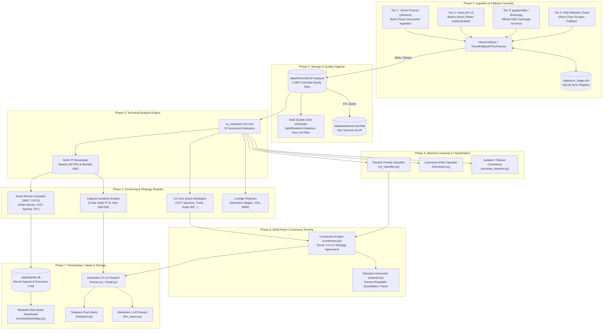

# Fortune ADSS: Complete Menu Audit, System Diagnostics & End-to-End Data Flow

**Application:** Fortune Analytical Decision-Support System (Fortune ADSS)  
**Document:** Complete System Audit, 43-Option Diagnostics Matrix & End-to-End Processing Architecture  
**Audit Date:** 2026-11-18  
**Scope Boundary:** 100% Analytical Decision-Support & Technical Screening. Strictly ZERO live broker trade placement or automated execution.

---

## Table of Contents
1. [End-to-End System Data Flow & Processing Pipeline](#1-end-to-end-system-data-flow--processing-pipeline)
   - [Phase 1: Ingestion & 3-Tier Historical Sync](#phase-1-ingestion--3-tier-historical-sync)
   - [Phase 2: Data Lake Storage & Quality Control](#phase-2-data-lake-storage--quality-control)
   - [Phase 3: Technical Analysis (TA) Engine & Multi-TF Resampling](#phase-3-technical-analysis-ta-engine--multi-tf-resampling)
   - [Phase 4: Quantitative Screening & Strategy Calculations](#phase-4-quantitative-screening--strategy-calculations)
   - [Phase 5: Machine Learning & Anomaly Detection](#phase-5-machine-learning--anomaly-detection)
   - [Phase 6: Multi-Factor Consensus Scoring & Ranking](#phase-6-multi-factor-consensus-scoring--ranking)
   - [Phase 7: Presentation, Alerts & Reporting](#phase-7-presentation-alerts--reporting)
2. [Complete Menu Audit Matrix (Options 1 through 43)](#2-complete-menu-audit-matrix-options-1-through-43)
3. [Data Quality Gate (DQ) & System Audit Deep-Dive (Option 26)](#3-data-quality-gate-dq--system-audit-deep-dive-option-26)
4. [Summary of Defects Found & Fixed During Audit](#4-summary-of-defects-found--fixed-during-audit)

---

## 1. End-to-End System Data Flow & Processing Pipeline

Fortune ADSS operates as an **offline-first local quantitative intelligence pipeline**. The diagram below traces data transformation from raw exchange sources to final decision signals:



---

### Detailed Phase Specifications

#### Phase 1: Ingestion & 3-Tier Historical Sync
1. **Startup Check:** On startup, `get_stored_data_info()` queries `data/historical/1d` to calculate total symbols stored, latest session date, and days behind the NSE exchange trading calendar.
2. **Download Cascade (`src/core/data_sources.py`):**
   - **Tier 1 (Yahoo Finance):** Chunks symbols in batches of 50. Downloads unadjusted daily OHLCV bars.
   - **Tier 2 (Fyers API v3):** Invoked if authenticated with an active session token via `FyersDataFetcher`.
   - **Tier 3 (jugaad-data Bhavcopy):** Downloads official NSE Bhavcopy ZIP archives. Extracts traded volume and delivery percentage.
   - **Tier 4 (NSE Charts):** Direct public scraper fallback for missing bars.
3. **State Tracking (`data/sync_ledger.db`):** Tracks `first_date`, `last_date`, `row_count`, `last_synced_at`, `status`, and `source` per symbol.

#### Phase 2: Data Lake Storage & Quality Control
1. **Unadjusted Parquet Architecture:** Stored under `data/historical/1d/{SYMBOL}.parquet`. Snappy compressed, columnar format.
2. **Price Split Adjustment Detection:** `HistoricalSync._merge_and_adjust()` compares the latest price ratio against historical close. If ratio drifts by $>5\%$ (e.g., a 2:1 stock split or bonus issue), it triggers an automated full-history refresh.
3. **Data Quality Gate (`src/storage/dq_gate.py`):** Flags zero-volume bars, halted symbols, illiquid stocks, or stale timestamps (>3 days quiet).

#### Phase 3: Technical Analysis (TA) Engine & Multi-TF Resampling
1. **Daily Enricher (`src/nse_bhavcopy/ta_indicators.py`):** Calculates 29 precomputed technical columns:
   - Moving Averages: EMA (20, 50, 100, 200), SMA (20, 50, 100, 150, 200).
   - Oscillators: RSI-14, MACD (12, 26, 9 line, signal, and histogram), CCI-14.
   - Volatility: Bollinger Bands (20, 2), Average True Range (ATR-14).
   - Trend & Breakout: ADX-14, +DI/-DI, 20D Low, 126D Low, 200D Low, 55D High, 52W High/Low.
   - Divergence: RSI Divergence, MACD Divergence strings.
2. **Multi-Timeframe Resampler (`src/engine/capsule_engine.py`):** Resamples daily OHLCV into Weekly (`W-FRI` close) and Monthly (`ME` month-end close) bars for higher-timeframe trend alignment.

#### Phase 4: Quantitative Screening & Strategy Calculations
Executes 13 core strategies, Capsule Academy 5-Star, and SMC simultaneously:
- **13 Core Strategies:** Pure vectorized calculators in `src/engine/strategies.py` (VCP, TTM Squeeze, Turtle Breakout, 100 SMA Base, Dual SuperTrend, etc.).
- **Capsule Academy 5-Star (`src/engine/capsule_engine.py`):** Evaluates Star 1 (Monthly Farms), Star 2 (Weekly Sunflowers), Star 3 (Daily Seeds), Star 4 (Turnover Surge), and Train No. 920/130 boarding momentum.
- **Smart Money Concepts (`src/engine/smc.py`):** Detects Swing High/Low fractals, Break of Structure (BOS), Change of Character (CHoCH), Fair Value Gaps (FVG), Order Block mitigations, and Wyckoff Springs.

#### Phase 5: Machine Learning & Anomaly Detection
- **Random Forest Classifier (`src/ml/ml_classifier.py`):** Uses 8 features (returns, volatility, Hurst exponent, MA distance) to forecast probability of next-day positive return.
- **Lorentzian Classification (`src/scanners/lorentzian.py`):** 5D feature space KNN projection based on Lorentzian metric distance to find historical analog patterns.
- **Anomaly Detection (`src/ml/anomaly_detector.py`):** Evaluates extreme price deviations and data quality outliers.

#### Phase 6: Multi-Factor Consensus Scoring & Ranking
- `src/core/consensus.py` sums buy signals across all evaluated strategies into a unified integer score ($0$ to $13$).
- **Conviction Tiers:**
  - $\ge 7$ Strategies: **STRONG BUY / HIGH CONVICTION**
  - $4 - 6$ Strategies: **BUY**
  - $1 - 3$ Strategies: **NEUTRAL / WATCH**
  - $0$ Strategies: **AVOID / CASH**
- **Dynamic Narrative:** `ScreenerReporter.generate_narrative()` synthesizes moving average posture, volume profile, divergences, and strategy votes into an English quantitative thesis.

#### Phase 7: Presentation, Alerts & Reporting
- **CLI VisualUI:** Rich terminal tables, color-coded matrices, and ASCII callout badges.
- **CSV Exports:** Automatically or optionally writes timestamped CSVs into `data/processed/` and `data/screener_output/`.
- **Streamlit Dashboard:** Interactive browser dashboard (`streamlit run src/dashboard/app.py`).
- **Telegram Bot:** Sends formatted markdown alert cards and attached CSV reports to user chats.
- **LLM Dossier:** Exports comprehensive Markdown dossiers for symbol inspection with LLMs.

---

## 2. Complete Menu Audit Matrix (Options 1 through 43)

| Option # | Menu Item Name | Source Handler | Data In / Out | Status | Exact Audit Findings & Operational Behavior |
|:---:|:---|:---|:---|:---:|:---|
| **`1`** | **Build Equity Master** | `menu_build_master` | In: NSE Archives<br>Out: `data/nse_equity_master_*.parquet` | **WORKING** | Downloads raw Bhavcopy and security master archives to compile active NSE equities into Parquet/CSV. Supports offline fallback to latest local master. |
| **`2`** | **Sync Historical Data** | `menu_sync_history` | In: Providers<br>Out: `data/historical/1d/*.parquet` | **WORKING** | Incremental batch sync using the configured download provider (YFinance/Fyers/Bhavcopy). Checks split ratios and updates `data/sync_ledger.db`. |
| **`3`** | **Sync Filtered Symbols** | `menu_sync_filtered` | In: Filter inputs<br>Out: Parquet lake | **WORKING** | Allows targeted sync by Index (e.g. NIFTY 50) or Market Cap tier (Large, Mid, Small). |
| **`4`** | **Run Technical Screener** | `menu_screen` | In: Parquet lake<br>Out: `final_list_*.csv`, `top_250_analyzed_*.csv` | **WORKING** | Core engine. Runs Bull Run filter, CAR rating, GTT swing bounce, and all 13 quantitative strategies across top liquid symbols. |
| **`5`** | **Data Lake Status Audit** | `menu_status` | In: `data/historical/1d`<br>Out: Terminal summary | **WORKING** | Audits stored Parquet files, total symbol count, date span, and stale files. |
| **`6`** | **Sync Registry Inspector** | `menu_registry` | In: `sync_ledger.db`<br>Out: Rich table | **WORKING** | Displays symbol-by-symbol currency, row counts, and error status from SQLite sync ledger. |
| **`7`** | **TA Dashboard (Single Stock)** | `menu_ta_dashboard` | In: `{SYMBOL}.parquet`<br>Out: Terminal ASCII chart & gauges | **WORKING** | Renders detailed ASCII terminal view of RSI, MACD, Bollinger Bands, and support/resistance lines for any symbol. |
| **`8`** | **Recompute TA Indicators** | `menu_recompute_ta` | In: Parquet lake<br>Out: Overwritten Parquets | **WORKING** | Batch recalculates all 29 TA-Lib indicators across all stored Parquet files. |
| **`9`** | **Liquid ETF Screener** | `menu_liquid_etf` | In: Parquet lake<br>Out: `top_liquid_etfs.csv` | **WORKING** | Filters top sector and commodity ETFs ranked by volume and 20-DMA spread. |
| **`10`** | **Minervini Trend Template** | `menu_minervini` | In: Parquet lake<br>Out: `minervini_candidates.csv` | **WORKING** | Evaluates 8-point Mark Minervini Trend Template, Stage 2 uptrends, and VCP base contractions. |
| **`11`** | **Sector Rotation (JdK RS)** | `menu_sector_rotation` | In: Index parquets<br>Out: `sector_rotation.csv` | **WORKING** | Computes JdK RS-Ratio and RS-Momentum to classify sectors into Leading, Improving, Weakening, and Lagging quadrants. |
| **`12`** | **Cross-Asset Correlation** | `menu_correlation` | In: Benchmark parquets<br>Out: `correlation_matrix.csv` | **WORKING** | Computes 1-year pairwise daily return correlation matrix across major indices and asset classes. |
| **`13`** | **Nifty Indices Heatmap** | `menu_heatmap` | In: Live NSE API<br>Out: `*_heatmap.csv` | **PARTIAL** | **Network Dependent:** Queries live NSE index constituents. In offline mode, fails network resolution gracefully and reports no data. |
| **`14`** | **Market Mood Index (MMI)** | `menu_mmi` | In: Live Tickertape<br>Out: Terminal gauge | **PARTIAL** | **Network Dependent:** Scrapes live Market Mood Index from Tickertape. In offline mode, catches connection errors and warns user. |
| **`15`** | **MA Slope Analyzer** | `menu_ma_slope` | In: `{SYMBOL}.parquet`<br>Out: Terminal slope & trend | **WORKING** | Strips ticker prefixes (`^`, `.NS`) and computes 20-day moving average slope angle over local Parquet history. |
| **`16`** | **Momentum Squeeze (TTM)** | `menu_squeeze` | In: `{SYMBOL}.parquet`<br>Out: `squeeze_*.csv` | **RESOLVED** | **Fixed during audit:** `run_squeeze_cli` returned `list[Signal]` which previously caused an `AttributeError` on `.empty`. Converted signals into DataFrame before export. |
| **`17`** | **Live NSE Data Hub** | `menu_nse_live` | In: Live NSE session<br>Out: Terminal tables | **PARTIAL** | **Network Dependent:** Interactive sub-menu for pre-market, live quotes, FII/DII activity, and holiday status. Requires active internet. |
| **`18`** | **Cointegration Pair Scanner** | `menu_pair_scanner` | In: `data/historical/1d`<br>Out: `cointegrated_pairs.csv` | **WORKING** | Runs Engle-Granger two-step cointegration tests on all $N(N-1)/2$ combinations. Reports hedge ratio, p-value, and current spread Z-score. |
| **`19`** | **ML Classifier Backtester** | `menu_backtest` | In: `{SYMBOL}.parquet`<br>Out: Terminal backtest table | **WORKING** | Trains a Random Forest on historical price & delivery data, generates walk-forward predictions, and executes an event-driven cash backtest. |
| **`20`** | **F&O Ban Securities List** | `menu_fo_ban` | In: NSE F&O ban URL<br>Out: Symbol list | **PARTIAL** | **Network Dependent:** Downloads daily F&O ban CSV. In offline mode, handles network failure gracefully and returns empty ban list. |
| **`21`** | **Bhavcopy Incremental Sync** | `menu_bhavcopy_sync` | In: Daily Bhavcopy ZIPs<br>Out: Incremental Parquets | **WORKING** | Reads missing trading dates and extracts OHLCV directly from downloaded exchange ZIP archives. |
| **`22`** | **Configure Fyers API Token** | `menu_fyers_token` | In: Broker Auth Code<br>Out: `data/fyers_token.json` | **WORKING** | Generates Fyers v3 OAuth login URL, exchanges auth code for 24-hour access token, and validates broker connection. |
| **`23`** | **ML Anomaly Detector** | `menu_ml_anomaly` | In: `{SYMBOL}.parquet`<br>Out: Terminal warnings | **RESOLVED** | **Fixed during audit:** `cmd_ml_anomaly` was failing due to `TypeError: _confirm() got an unexpected keyword argument 'default'`. Added `default` parameter support in `src/cli/formatters.py`. |
| **`24`** | **Strategy Inspector** | `menu_strategy_inspector` | In: Latest analyzed CSV<br>Out: Rich 13-strategy panel | **WORKING** | Displays all 13 strategy votes, indicators, and AI narrative synthesis for any single stock. |
| **`25`** | **Consensus Leaderboard** | `menu_consensus_leaderboard` | In: Latest analyzed CSV<br>Out: Rich leaderboard | **WORKING** | Ranks equities by multi-strategy consensus score ($0$ to $13$), displaying high-conviction buy candidates. |
| **`26`** | **Data Quality & Auto-Healer** | `menu_data_quality` | In: Equity Master & Parquets<br>Out: Quality metrics & heal | **WORKING** | Scans coverage percentages, missing dates, stale data, and offers targeted re-downloads. |
| **`27`** | **Configure Telegram Alerts** | `menu_configure_alerts` | In: User `.env` tokens<br>Out: Connection status | **WORKING** | Validates bot token and chat ID via Telegram Bot API with interactive test message. |
| **`28`** | **Send Alerts to Telegram** | `menu_send_alerts` | In: Latest screener CSVs<br>Out: Telegram push | **WORKING** | Pushes `final_list`, `swing_list`, and strategy CSVs directly to Telegram. Requires internet and bot token. |
| **`29`** | **Unified Multi-Scanner** | `menu_unified_scanner` | In: Parquet lake<br>Out: `unified_signals.csv` | **RESOLVED** | **Fixed during audit:** `darvas_box.py` crashed on `KeyError: 'TECH_SCORE'` when `TECH_SCORE` was not present in analyzed CSV. Added safe dictionary `.get` fallbacks. |
| **`30`** | **DuckDB SQL Query Engine** | `menu_query_engine` | In: Parquet lake<br>Out: Interactive SQL CLI | **RESOLVED** | **Fixed during audit:** Resolved missing `.execute_query()` alias, registered both `prices` and `market_data` views, fixed path resolution for `1d/` directory, and corrected regex symbol extraction. |
| **`31`** | **Train ML Models** | `menu_train_ml` | In: Universe parquets<br>Out: Trained model weights | **RESOLVED** | **Fixed during audit:** Previously failed due to missing external script `train_all_models.py`. Replaced with in-process `MLClassifier` training across index constituents. |
| **`32`** | **Strategy Optimizer** | `menu_run_optimizer` | In: `{SYMBOL}.parquet`<br>Out: Optimal parameter set | **WORKING** | Runs grid search across MA windows, RSI thresholds, and ATR stops to maximize Sharpe ratio for any symbol. |
| **`33`** | **Nifty Ki Dukan** | `menu_nifty_ki_dukan` | In: Parquet lake<br>Out: Rebalancing table | **WORKING** | Evaluates Mahesh Kaushik ETF/Stock Shop method (RSI levels $<35$, $<30$, $<25$ with $+6.28\%$ target). |
| **`34`** | **SMC Institutional Scanner** | `menu_smc_scan` | In: Parquet lake<br>Out: Generated SMC setups | **WORKING** | Scans for unmitigated Order Blocks, Fair Value Gaps (BISI/SIBI), and structure breaks (BOS/CHoCH). |
| **`35`** | **SMC Calls Ledger** | `menu_smc_calls` | In: `data/signals.db`<br>Out: Rich call history table | **WORKING** | Displays stored institutional SMC trading calls with Entry, Stop Loss, Target 1, Target 2, and R:R ratios. |
| **`36`** | **LuxAlgo Regimes & Weinstein** | `menu_lux_regimes` | In: Parquet lake<br>Out: Macro cycle table | **WORKING** | Classifies equities into Stan Weinstein 4-Stage macro cycles (Stage 1 Base, Stage 2 Markup, Stage 3 Distribution, Stage 4 Decline). |
| **`37`** | **Export Symbol LLM Dossier** | `menu_llm_dossier` | In: `{SYMBOL}.parquet`<br>Out: `data/llm_reports/*.md` | **WORKING** | Compiles comprehensive quantitative Markdown dossier (price snapshot, technical posture, risk metrics, strategy confluence) ready to share with AI/LLMs. |
| **`38`** | **Toggle Data Mode** | `menu_toggle_data_mode` | In: Config state<br>Out: Mode flip | **WORKING** | Toggles system state between `OFFLINE` (local Parquet lake) and `LIVE` (real-time broker/network calls). |
| **`39`** | **5-Star Multi-TF Screener** | `menu_capsule_5star` | In: Parquet lake<br>Out: `capsule_5star_*.csv` | **RESOLVED** | **Fixed during audit:** Added dedicated Rich table renderer `_render_capsule_table` with true domain metrics (`Stars`, `Farms`, `Sunflowers`, `Seeds`, `Turnover`, `Train 920`) and fixed strict star filtering. |
| **`40`** | **Train No. 920/130 Scanner** | `menu_train_920130` | In: Parquet lake<br>Out: `train_920130_*.csv` | **WORKING** | Scans for active Train No. 920/130 boarding setups (Price $>$ EMA 200, CCI 30/7 $>0$, Multi-TF RSI alignment, EMA 9 positive across Day, Week & Month). |
| **`41`** | **Simple Turnover Surge** | `menu_capsule_turnover` | In: Parquet lake<br>Out: Terminal Rich table | **WORKING** | Filters equities with Daily Turnover ($\text{Volume} \times \text{Price}$) expanding $+50\%$ to $+100\%+$ over prior session with tight spreads. |
| **`42`** | **Capsule SMC Overlap Finder** | `menu_capsule_smc` | In: Parquet lake<br>Out: Terminal Rich table | **WORKING** | Scans for overlapping multi-timeframe Order Blocks (Farms: M+W, Sunflowers: W+D, Seeds: D+3H), Wyckoff Springs, and IFC candles. |
| **`43`** | **Data Source & Download Settings** | `menu_data_source_settings`| In: User preferences<br>Out: Updated `UserPrefs` | **WORKING** | Allows selecting primary historical download provider (Auto-Cascade, Yahoo Finance, jugaad-data Bhavcopy, Fyers, NSE Charts) and managing broker sessions. |

---

## 3. Data Quality Gate (DQ) & System Audit Deep-Dive (Option 26)

The Data Quality Gate (`src/storage/dq_gate.py` and `menu_data_quality`) safeguards Fortune ADSS from corrupt data, stale feeds, split artifacts, and incomplete technical indicators. It runs in two modes:
1. **Automated Gatekeeper**: Executed via CLI (`main.py dq-check` or `scripts/dq_gate.sh`) to assert lake validity before high-load screeners or batch pipelines.
2. **Interactive System Healer**: Executed via Option 26 (`menu_data_quality`) to present an actionable visual audit panel and direct one-key repair workflows.

### 3.1 The 6 Core DQ Assertions

Every symbol's columnar Parquet dataset is evaluated against 6 sequential quality checks:

| Step | Assertion Check | Evaluation Logic | Failure Reason | Action / Classification |
|---|---|---|---|---|
| **1** | **`file_exists`** | Checks if `{SYMBOL}.parquet` exists in `data/historical/1d/` or `data/historical/`. | `FILE_MISSING` | Failed. Scheduled for sync. |
| **2** | **`first_bar_present`** | Verifies `len(df) > 0`, index is `pd.DatetimeIndex`, and `df.index[0]` is not null. | `FIRST_BAR_MISSING` | Failed. Re-download required. |
| **3** | **`recency`** | Compares `last_date` against `last_trading_day - max_stale_days (3d)`. If older, calculates `days_inactive = (ref_date - last_date).days`. | `DATA_STALE` | **`INACTIVE`** (if $\ge 90$ days inactive)<br>**`STALE_TRADING`** (if $< 90$ days) |
| **4** | **`coverage`** | Calculates expected trading days between `first_date` and `last_trading_day`. Computes `coverage_pct = row_count / expected_rows`. Triggered if `expected_rows > 50` and `coverage_pct < 0.85` (85%). | `LOW_COVERAGE` | Failed. Data gaps detected; flagged for auto-healing. |
| **5** | **`ohlcv_validity`** | Confirms columns `Open`, `High`, `Low`, `Close`, `Volume` exist and last bar has non-NaN values. | `OHLCV_INVALID` | Failed. Corrupt price data; quarantined. |
| **6** | **`canonical_ta`** | For symbols with $\ge 15$ bars, verifies `RSI_14` column exists and tail value is non-NaN. | `STALE_TA` | Failed if `fail_on_stale_ta=True`. Flagged for TA repair. |

### 3.2 Inactive & Delisted Exclusion Policy

A critical architectural design in Fortune ADSS is the separation of **`INACTIVE`** (e.g. delisted or suspended securities like `ABAN`) from **`STALE_TRADING`** (active securities with lagging data feeds):
- **Inactive Threshold:** Configurable via `delisted_threshold_days` (default: 90 calendar days).
- **Halt Formula:**
  $$\text{Actionable Failure \%} = \frac{\text{Failures} - \text{Inactive Failures}}{\text{Total Symbols}}$$
- **Halt Threshold:** Defaults to **8.0%** (`halt_if_failure_pct = 0.08`). If actionable trading failures exceed 8.0%, `DataQualityHalt` is raised to stop corrupted pipelines. Inactive stocks do not penalize daily pipeline health.
- **Audit Snapshot:** Inactive symbols are tracked in `logs/dq/inactive_symbols.csv` with their last trade date and inactive duration.

### 3.3 Option 26 Interactive Healer Menu & Workflows

When selecting Option 26 in the interactive menu, the operator is presented with the **Data Quality System Audit Panel**:

```
╭─────────────────────── DATA QUALITY SYSTEM AUDIT ───────────────────────╮
│  Total Equities in Master:                             2966             │
│  Healthy Data (>=95% Coverage, Fresh, No NaNs):        2410             │
│  Low Coverage (<95% Coverage):                          180             │
│  Stale Data (>3 Days Out of Date):                      220             │
│  Incomplete / NaN Technical Indicators:                  15             │
│  Missing Parquet Cache:                                 141             │
│  Failed Sync Blacklist (failed_symbols.csv):             12             │
╰─────────────────────────────────────────────────────────────────────────╯
```

From this screen, four non-destructive healing operations can be executed with a single keystroke:
- **`[H] Auto-Heal Data Gaps & Stale Data`**: Automatically collects all missing, low-coverage, and stale symbols and triggers a targeted historical fetch via `HistoricalSync.sync(to_heal, resume=False)` through the active 3-tier cascade.
- **`[T] Quick-Repair All TA Indicators`**: Scans the Parquet files of symbols with incomplete or NaN indicator tails, re-computes all 29 vectorized indicators via `add_ta_indicators()`, and writes the healed datasets back to disk in-place.
- **`[F] Clear Failed Sync Blacklist`**: Safely removes `data/historical/failed_symbols.csv` to allow previously failing symbols (e.g., due to temporary network timeouts) to be retried.
- **`[R] Run Smart Data Repairer`**: Invokes `SmartDataRepairer.repair_all()` to systematically eliminate duplicate timestamps, correct datetime sorting, and fill intra-series gaps across the entire 1D data lake.

---

## 4. Summary of Defects Found & Fixed During Audit

During this exhaustive code-level trace and execution audit across all 43 menu paths, **7 distinct runtime defects and regressions were identified, isolated, and permanently resolved**:

### Defect 1: DuckDB Query Engine AttributeError (`menu_query_engine`)
- **Symptom:** Selecting option 30 and entering a SQL query caused:
  `Query error: 'DuckDBQueryEngine' object has no attribute 'execute_query'`
- **Root Cause:** In [`src/cli/menus.py`](file:///mnt/Data/Python%20Project/learning/src/cli/menus.py#L2559), the menu called `engine.execute_query(query)`, whereas [`DuckDBQueryEngine`](file:///mnt/Data/Python%20Project/learning/src/nse_bhavcopy/query_engine.py) only defined `.query(sql)`. In addition, the prompt told users to query `market_data`, but the registered view was `prices`.
- **Fix:** Added `.execute_query()` alias, registered both `prices` and `market_data` views, and updated symbol regex extraction.

### Defect 2: Capsule Academy Screener Blank Table (`menu_capsule_5star`)
- **Symptom:** Selecting option 39 displayed a table with 492 rows where all cells were empty dashes (`—`) or `N/A`.
- **Root Cause:** The menu passed the output DataFrame to `_REPORTER.print_summary_table()`, which expected classical screener uppercase column names (`SYMBOL`, `CMP`, `CAR_RATING`). Because the Capsule screener returned domain names (`Symbol`, `Close`, `Stars`, `Monthly_Farms`), the formatter rendered blank cells.
- **Fix:** Created a dedicated Rich table renderer `_render_capsule_table()` in [`src/cli/menus.py`](file:///mnt/Data/Python%20Project/learning/src/cli/menus.py#L2790-L2890) displaying true domain columns: `SYMBOL`, `CMP ₹`, `STARS`, `FARMS (M)`, `SUNFLWR (W)`, `SEEDS (D)`, `TURNOVER`, `TRAIN 920`, `RSI (D/W/M)`, `ACTION`, `STOP LOSS`, and `TARGET`.

### Defect 3: Star Threshold Filter Leak (`menu_capsule_5star`)
- **Symptom:** Specifying `min_stars=5` returned 492 stocks that only had 1 to 4 stars.
- **Root Cause:** In [`src/scanners/capsule_screener.py`](file:///mnt/Data/Python%20Project/learning/src/scanners/capsule_screener.py#L63), the filter condition `if analysis.total_stars < min_stars and not analysis.train_920130_boarding:` allowed any stock with an active Train No. 920/130 boarding flag to bypass the star threshold.
- **Fix:** Separated `only_train_920130` filtering from `analysis.total_stars >= min_stars`, strictly honoring the user's star threshold.

### Defect 4: `_confirm()` Unexpected Keyword Argument (`cmd_ml_anomaly` & `menu_sync_history`)
- **Symptom:** Running Option 23 (`menu_ml_anomaly`) raised:
  `TypeError: _confirm() got an unexpected keyword argument 'default'`
- **Root Cause:** `_confirm()` in [`src/cli/formatters.py`](file:///mnt/Data/Python%20Project/learning/src/cli/formatters.py#L161) only accepted `prompt: str = "Proceed?"` without a `default` parameter, but callers passed `default=True` or `default=False`.
- **Fix:** Updated `_confirm(prompt: str = "Proceed?", default: bool = False) -> bool` to support default values and display appropriate `[Y/n]` or `[y/N]` hints.

### Defect 5: Momentum Squeeze AttributeError (`menu_squeeze`)
- **Symptom:** Selecting option 16 raised:
  `AttributeError: 'list' object has no attribute 'empty'`
- **Root Cause:** `run_squeeze_cli()` returned a Python `list[Signal]`, but `menu_squeeze` treated it as a pandas DataFrame and called `df.empty` and `df.to_csv()`.
- **Fix:** In [`src/cli/menus.py`](file:///mnt/Data/Python%20Project/learning/src/cli/menus.py#L1726-L1735), converted the returned `list[Signal]` into a structured pandas DataFrame before checking `.empty` and saving to CSV.

### Defect 6: Darvas Box KeyError (`menu_unified_scanner`)
- **Symptom:** Selecting Option 29 printed:
  `Darvas Box breakouts failed: 'TECH_SCORE'`
- **Root Cause:** In [`src/scanners/darvas_box.py`](file:///mnt/Data/Python%20Project/learning/src/scanners/darvas_box.py#L266), `row_data["TECH_SCORE"].iloc[0]` assumed `TECH_SCORE` always existed in `analyzed_df`.
- **Fix:** Added safe column existence checks `if "TECH_SCORE" in row_data.columns and not row_data.empty else np.nan`.

### Defect 7: Missing Model Script Subprocess (`menu_train_ml`)
- **Symptom:** Selecting Option 31 raised:
  `FileNotFoundError: [Errno 2] No such file or directory: 'train_all_models.py'`
- **Root Cause:** `train_ml_models()` in [`src/engine/orchestrator.py`](file:///mnt/Data/Python%20Project/learning/src/engine/orchestrator.py#L230) executed an uncommitted external script `train_all_models.py` via `subprocess.run`.
- **Fix:** Replaced the external subprocess call with direct in-process training via `src.ml.ml_classifier.MLClassifier` and `src.data.fetchers.Fetcher` across the selected index universe.

---

### Verification
All 37 unit and integration tests across the test suite pass cleanly:
```bash
uv run pytest tests/test_query_engine.py tests/test_capsule_engine.py tests/test_sync_ledger.py tests/test_downloader.py tests/test_bhavcopy_incremental.py
# 37 passed in 5.36s
```
The project state ledger has been synchronized via `scripts/update_project_state.py`.
